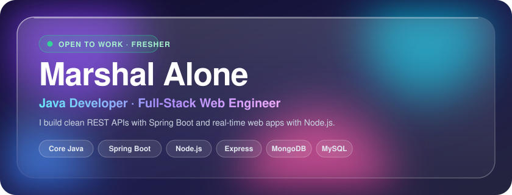
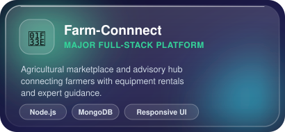
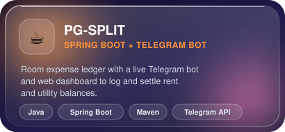
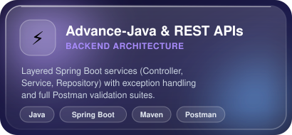
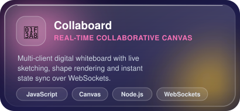

 

 

---

## 👨‍💻 About Me

- 🎓 B.Tech Computer Science & Engineering student.
- 💻 Aspiring Java Developer and Full-Stack Developer.
- 🌱 Currently focusing on Java, Spring Boot, REST APIs and Full-Stack Development.
- 🔨 Interested in building practical applications and solving real-world problems through code.
- 📚 Continuously improving my Data Structures, Algorithms and backend development skills.
- 🎯 Looking for an opportunity to begin my career as a Software Developer.

---

## 🛠️ Technical Skills

### Programming Languages

### Backend Development

### Frontend Development

### Databases

### Developer Tools

---

## 🚀 Featured Projects

A selection of projects where I've applied my development skills to build practical applications.

### 🌾 Farm-Connnect

**An agricultural marketplace and advisory platform connecting farmers with equipment rentals and expert guidance.**

### ☕ PG-SPLIT

**A room expense management application with a Spring Boot backend, web dashboard and Telegram bot integration.**

### ⚡ Advance Java & REST APIs

**Backend development using layered architecture, Spring Boot REST APIs and exception handling.**

### 🎨 Collaboard

**A collaborative digital whiteboard featuring real-time drawing and synchronization using WebSockets.**

### 🕹️ Interactive Web Playground

**A collection of interactive applications and mini-projects built using HTML, CSS and JavaScript.**

---

## 📈 GitHub Activity

 

---

## 🤝 Let's Connect

I'm always interested in connecting with developers, learning from others and exploring software development opportunities.

  

  

**Building. Learning. Improving. One commit at a time.** 🚀

